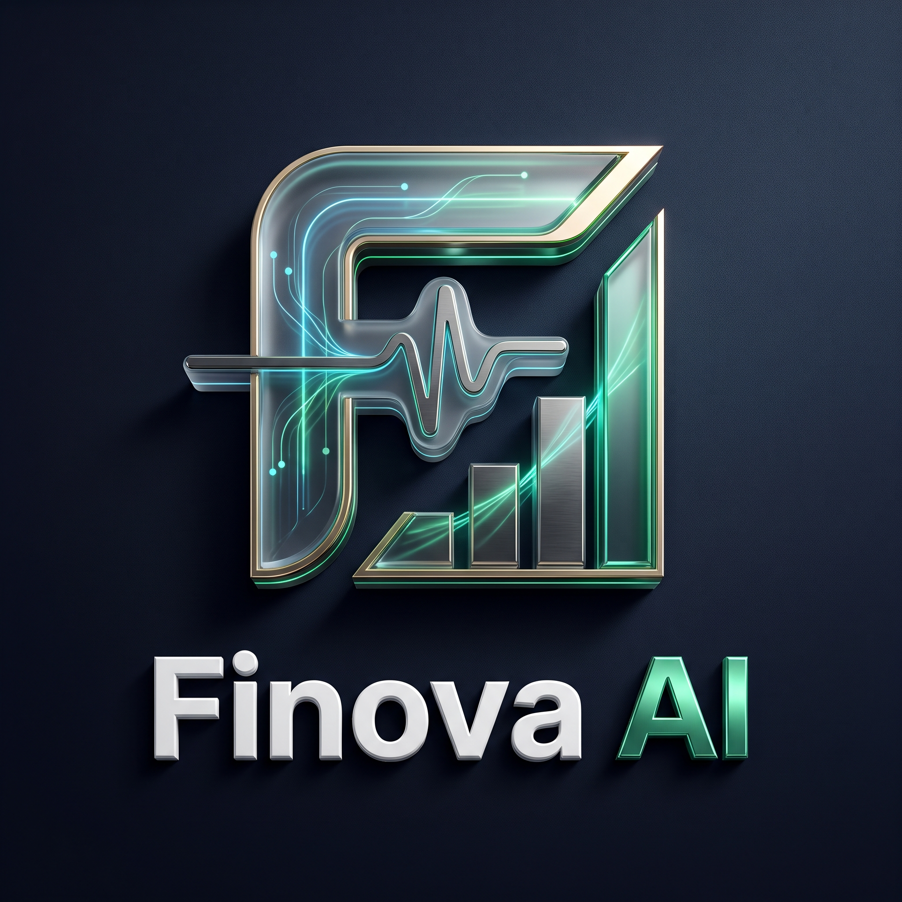

<div align="center">
  
  <h1>Finova AI</h1>
  <p><strong>Controle Financeiro Pessoal Inteligente com IA e WhatsApp</strong></p>

  <p>
    <a href="./README.md">🇧🇷 Português</a> •
    <a href="./README.en.md">🇺🇸 English</a> •
    <a href="./README.es.md">🇪🇸 Español</a>
  </p>

  <p>
    
    
    
    
  </p>
</div>

---

## 📋 Sobre o Projeto

O **Finova AI** é um Micro-SaaS de controle financeiro pessoal desenvolvido pela **Marks Systems**[cite: 1]. O sistema elimina o atrito operacional das planilhas e aplicativos tradicionais integrando mensageria instantânea via **WhatsApp** (texto, áudio e fotos de comprovantes) a um **painel web analítico de nível executivo**[cite: 1, 5].

### 🎯 Principais Diferenciais
- **Registro em Menos de 10 Segundos:** Envie áudios curtos, mensagens de texto simples ou fotos de comprovantes diretamente no WhatsApp[cite: 1, 5].
- **Modo Anti-Ilusão (Cheque Especial):** Separação contábil estrita entre saldo próprio líquido e limite de cheque especial bancário, com alertas preditivos e cálculo de juros diários[cite: 1, 6, 8].
- **Gestão Multi-Contas e Cartões:** Suporte para Conta Principal (salário), contas secundárias, transferências internas sem duplicidade e hierarquia de cartões de crédito[cite: 1, 6].
- **Onboarding Retroativo (30 Dias):** Importação em lote de extratos bancários em PDF/CSV assistida por Inteligência Artificial[cite: 1, 6, 7].
- **Dashboard Executivo com IA:** 6 módulos visuais de alta densidade acompanhados de blocos ativos de diagnóstico e recomendações de economia[cite: 5, 7].
- **Modo Privacidade:** Ocultação instantânea de valores monetários (`••••`) na interface para navegação segura em locais públicos.

---

## 🛠️ Stack Tecnológica

- **Frontend:** Next.js 15 (App Router), React, TypeScript, Tailwind CSS, shadcn/ui, Recharts[cite: 3]
- **Backend & Banco de Dados:** Supabase (PostgreSQL, Supabase Auth, Row Level Security, Edge Functions)[cite: 3]
- **Inteligência Artificial:**
  - **Groq Cloud (`whisper-large-v3`):** Transcrição de áudio em tempo real (< 800ms)[cite: 3, 8]
  - **Google AI Studio (`Gemini 1.5 Flash`):** Visão computacional (OCR de comprovantes), leitura de PDFs e categorização estruturada[cite: 3]
- **Mensageria WhatsApp:** Evolution API (Node.js/Baileys) com webhook automatizado[cite: 1, 3]
- **Pagamentos:** Mercado Pago (Checkout Transparente — Pix e Cartão de Crédito)[cite: 3]
- **Hospedagem & CI/CD:** Vercel Platform[cite: 3]

---

## 🚀 Como Executar Localmente

### Pré-requisitos
- Node.js `18.17+` ou `20+`
- Gerenciador de pacotes (`npm`, `yarn`, `pnpm` ou `bun`)
- Conta no Supabase, Groq Cloud, Google AI Studio e instância Evolution API

### Passo a Passo

1. **Clone o repositório:**
   ```bash
   git clone [https://github.com/marks-systems/finova-ai.git](https://github.com/marks-systems/finova-ai.git)
   cd finova-ai
